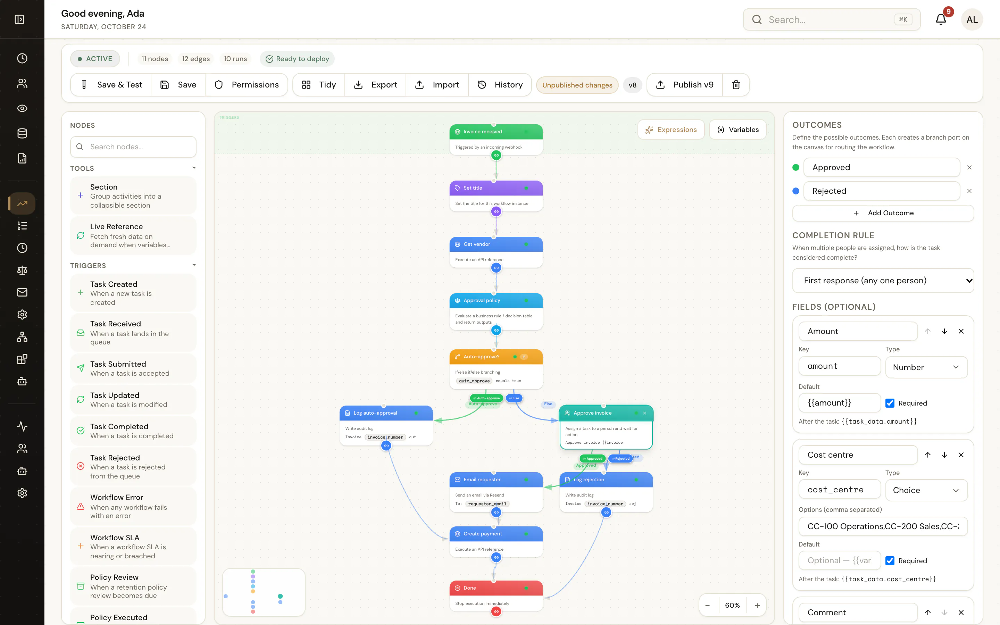

<p align="center">
  <picture>
    <source media="(prefers-color-scheme: dark)" srcset="public/brand/wordmark-light.svg">
    
  </picture>
</p>

# UserTasks

<!-- badges:start -->
[](https://github.com/homepresso/User-Tasks/actions/workflows/ci.yml)
[](https://www.npmjs.com/package/@usertasks/sdk)
[](https://www.npmjs.com/package/@usertasks/cli)
[](LICENSE)
<!-- badges:end -->
UserTasks is a workflow engine with human tasks built in. You design
workflows on a visual canvas or author them as JSON through the API and MCP,
and the engine runs them: integrations, data tables, decision tables, AI
agents, Office document generation, and user tasks that pause a run until
someone approves, rejects or completes them.

It is built to be embedded. Everything the UI does is available through a
REST API (`/api/v1`), an MCP server (`/api/mcp`) and an OAuth
authorization server (PKCE), so other applications and AI assistants can start
workflows, act on tasks and read reports.

The hosted edition runs at [usertasks.com](https://usertasks.com). This
repository is the same codebase, licensed under Apache-2.0 and self-hostable.



## Documentation

The docs site is part of the app at `/docs` (served in both deployment modes;
[usertasks.com/docs](https://usertasks.com/docs) for the hosted edition):
quickstarts, concepts, the designer, the [node](https://usertasks.com/docs/workflows/nodes)
and [expression function](https://usertasks.com/docs/workflows/functions) references,
tasks, integrations, governance, the REST API, MCP, the
[CLI](https://usertasks.com/docs/cli), [log export](https://usertasks.com/docs/observability)
and [self-hosting](https://usertasks.com/docs/self-hosting). Reference pages (nodes,
functions, permissions, OAuth scopes, MCP tools, CLI commands, REST endpoints,
environment variables) are generated from the code at build time, and
`__tests__/docs-reference.test.ts` fails when something is added without docs.
Content lives in `lib/docs/` (Markdown in TypeScript, rendered by
`app/docs/[...slug]`); `docs/self-hosting.md`, `docs/migrations.md`,
`docs/perf/results.md`, `docs/export-coverage.md` and `docs/changes/*.md` are included as they are.
Screenshots in `public/screenshots/` are captured from a seeded local demo
workspace with `scripts/screenshots/` (see its README).

## What's included

- **Workflow engine and designer**: triggers (webhook, schedule, task and
  data-table events, SLA and error events), 70+ inline expression functions, conditions, loops,
  parallel branches, sub-workflows, error handling, run history and traces.
- **Tasks**: task list, queue and tracker; task detail with approve, reject
  and complete outcomes, notes, a small set of typed fields defined on the
  User Task node, SLAs, reminders, escalations, dependencies and subtasks.
- **Integrations**: REST, OData, OAuth connectors, inbound and outbound
  webhooks, OpenAPI import, database connectors (Postgres, SQL Server, MySQL,
  Oracle, MongoDB, Snowflake; the last three drivers are optional installs, see
  [optional drivers](docs/optional-drivers.md)), plus an OData
  endpoint over your own data.
- **Decision tables, data tables, AI agents, email templates**, Office file
  generation (Word, Excel, PowerPoint) and CSV/Excel parsing.
- **Reports** over tasks, workflow runs and data, available in the UI, the
  API and MCP.
- **Governance**: tenants, roles and permissions, teams, API keys, SSO and
  directory sync, audit and activity logs, retention policies, a deletion
  queue, and GitHub sync of tenant configuration.

## Architecture

- **Next.js 16** (App Router) with **React 19**, TypeScript and Tailwind CSS 4.
  Pages live in `app/`, shared code in `lib/`, UI in `components/`.
- **Supabase** by default: Postgres with row-level security per tenant, Auth,
  Storage, Vault, and `pg_cron` + `pg_net` for scheduled work. Every
  infrastructure area has its own provider, so an install can move to AWS,
  Azure, Google Cloud or fully on-premises one area at a time (see
  [Choose your topology](docs/topologies/README.md)).
- **Engine**: `lib/workflow-engine.ts` executes runs; node types are declared
  in `lib/workflow-schema.ts` and validated by `lib/workflow-validation.ts`.
  Runs are queued and drained by `lib/workflow-queue-processor.ts` through
  `/api/workflows/process`.
- **Scheduler**: one pg_cron job calls `/api/cron/tick` every minute with a
  shared secret; the tick runs the due jobs from `lib/jobs/registry.ts`
  (see [Scheduled jobs](#scheduled-jobs)).

## Quick start

Requirements: Node.js 20 or later, and a Supabase project (hosted, or local
via the Supabase CLI and Docker).

Every install starts here, on Supabase, with no provider settings. Supabase
is an excellent platform and our recommended way to run UserTasks. If you'd
like files, email, secrets, sign-in or the database somewhere else (your AWS,
Azure or Google Cloud account, or your own servers), you can move one area at
a time with `usertasks-admin switch` whenever you're ready: [Choose your topology](docs/topologies/README.md)
has a decision guide, a guide per topology (Supabase only, hybrid, AWS, Azure,
Google Cloud, multi-cloud, on-premises) and
[the options in each area](docs/services/README.md). To start on other services
from day one, `npm run stack -- up` runs the standalone profile (PostgreSQL, MinIO,
the worker); see [Deployment profiles](docs/deployment-profiles.md).

`supabase/migrations/` builds a fresh database from scratch (a baseline schema
plus a few follow-up migrations); see [docs/migrations.md](docs/migrations.md).

```bash
git clone https://github.com/homepresso/User-Tasks.git usertasks && cd usertasks
npm install

# 1. Database: either a local stack...
npx supabase init                            # first time only
npx supabase start && npx supabase db reset  # applies supabase/migrations
# ...or a hosted project
npx supabase link --project-ref <ref> && npx supabase db push

# 2. Configuration
cp .env.example .env.local                   # fill in the Supabase URL and keys

# 3. First organisation and owner account
set -a; . ./.env.local; set +a
npm run bootstrap -- --email admin@example.com --password 'a-strong-password' --org "Acme Inc"

# 4. Run
npm run dev
```

Open http://localhost:3000, sign in with the organisation slug printed by
`bootstrap`, your email and password, and finish setup at `/onboarding`.

Every environment variable is listed and explained in
[`.env.example`](.env.example).

## Deployment modes

`DEPLOYMENT_MODE` (see `lib/deployment.ts`) selects the edition:

| | `self_hosted` (default when unset) | `cloud` |
|---|---|---|
| `/` | Redirects to `/tasks` or `/login` | Marketing landing page |
| Marketing and SEO pages, `/contact` | 404 | Served |
| Self-signup | Disabled; use `npm run bootstrap` and invitations | Enabled |
| `robots.txt` / sitemap | Disallow all / empty | Normal |

Public docs (`/docs`) are served in both modes. Some of the affected routes
are statically rendered, so set `DEPLOYMENT_MODE` at build time as well as
at runtime.

For production, run `npm run build && npm start`, or use the `Dockerfile` and
`docker-compose.yml` (app only; the database stays in Supabase). The full
guide is [docs/self-hosting.md](docs/self-hosting.md); for other clouds and
on-premises, see [Choose your topology](docs/topologies/README.md).

## Scheduled jobs

Schedule triggers, the workflow and agent queues, SLA checks, reminders,
escalations, retention, the deletion queue, GitHub sync, directory sync,
log export shipping and OAuth token refresh are listed in `lib/jobs/registry.ts`.
A single **pg_cron** job, `usertasks-tick`, calls `/api/cron/tick` every
minute and the app runs the jobs due in that minute; a second, pure-SQL job
purges pg_cron's run history daily. The tick reads two Vault secrets,
`cron_secret` (matching `CRON_SECRET`) and `app_base_url`. Setup is in
[docs/self-hosting.md](docs/self-hosting.md#3-scheduled-jobs-pg_cron--vault).

`vercel.json` declares three daily Vercel crons as a fallback for Vercel
deployments; pg_cron is the primary scheduler.

## API, MCP and OAuth

- **Docs**: `/docs/api` (authentication, envelope, errors), `/docs/api/endpoints`
  (every operation), `/docs/mcp` (setup and every tool) and `/docs/api-explorer`
  (interactive REST explorer).
- **REST**: `/api/v1/...`. The API covers:
  - tasks, workflows, runs and the queue;
  - integrations, connectors, email templates and activities;
  - decision tables and data tables;
  - roles, teams, invitations, API keys and webhooks;
  - reports, retention policies, GitHub sync, and config export and apply.

  Requests are authenticated with an API key (`Authorization: Bearer <key>`) or an OAuth
  access token. The OpenAPI 3.1 document is served at `/api/v1/openapi.json`.
- **SDK**: [`@usertasks/sdk`](packages/sdk/README.md) is a typed TypeScript client.
- **MCP**: streamable HTTP at `/api/mcp`, authenticated with an API key or
  an OAuth access token.
- **OAuth**: authorization code flow with PKCE. Discovery at
  `/.well-known/oauth-authorization-server` and
  `/.well-known/oauth-protected-resource`, dynamic client registration at
  `/api/oauth/register`, consent at `/oauth/consent`.

## CLI

[`@usertasks/cli`](packages/cli/README.md) gives you the `usertasks` command. It has a command
for every REST endpoint, plus browser login and config as code:

```bash
npm install -g @usertasks/cli
usertasks login --url https://tasks.example.com      # browser login; or: login --api-key
usertasks workflows list
usertasks config export ./config && usertasks config diff ./config

# edit a workflow: save the draft definition, edit it, send it back, publish
usertasks workflows definition <id> -o json > wf.json
usertasks workflows update <id> -f wf.json && usertasks workflows publish <id>
```

REST, MCP and the CLI cover the same operations for every configurable resource; see
[docs/parity.md](docs/parity.md).
Every artifact type can be exported and imported (app Export/Import buttons, config export/apply
on REST, MCP and the CLI, packages); the coverage matrix and what is excluded by design are in
[docs/export-coverage.md](docs/export-coverage.md).

In CI, set `USERTASKS_URL` and `USERTASKS_API_KEY` instead of logging in. For the full guide,
see `/docs/cli`, every command at `/docs/cli/commands` and recipes (dev → prod, CI, monitoring)
at `/docs/cli/recipes`. To work on the CLI in this repo, use `npm run cli:dev -- <args>` and
`npm run cli:build`. The packages are versioned and published separately; see
`.github/workflows/release.yml`.

## Observability / log export

Workflow runs and step logs, integration calls, agent runs, task lifecycle,
audit, security and system events go into one normalized event stream per
workspace (retained 72 hours by default). You can:

- **push** it to Splunk HEC, Datadog Logs, any OpenTelemetry collector
  (OTLP/HTTP) or a signed HTTPS webhook — Settings → **Log Export**, the
  `/api/v1/log-destinations` API, MCP, `usertasks log-destinations …` or
  config as code. Delivery is at least once, usually within seconds, with
  retries, lag tracking and a "Send test event" button;
- **pull** it with `GET /api/v1/events` (cursor) or stream it with
  `GET /api/v1/events/stream` (Server-Sent Events, `Last-Event-ID` resume);
- **tail** it from a terminal:

```bash
usertasks logs tail --category workflow --severity warn
usertasks logs export --since 1h > events.ndjson
usertasks log-destinations create -f splunk.json
```

Events never contain request/response bodies or headers, prompts, model
outputs, credentials or full audit diffs. Reading needs the
`observability.view` permission (OAuth scope `events:read`; audit and security
events also need `settings.view`), changing destinations needs `settings.edit`.
Self-hosted: destinations on private networks need `ALLOW_PRIVATE_EGRESS=true`,
private CAs `NODE_EXTRA_CA_CERTS`, and the shipper runs every minute from the
scheduler tick (same Vault secrets). Full guide: `/docs/observability`
(destinations at `/docs/observability/destinations`, event types at `/docs/observability/events`);
release note: [docs/changes/log-export.md](docs/changes/log-export.md).

## Performance

The queue processor claims jobs in batches and runs them concurrently
(`WORKFLOW_CONCURRENCY`, default 5), API keys are validated from a short
in-process cache, and RLS policies evaluate their tenant checks once per
query. On a local benchmark that took API requests from ~80 ms to 4–8 ms, a
member's task list from 1.5 s to 38 ms and a 200-job burst from ten cron
minutes to under a second; client JS is down a quarter. Numbers and caveats:
[docs/perf/results.md](docs/perf/results.md); the harness is
`scripts/bench/` (local stack only); release note:
[docs/changes/performance.md](docs/changes/performance.md).

## Testing

```bash
npm test               # Vitest unit tests (__tests__/)
npx tsc --noEmit -p .  # type check
npm run build
```

`test-workflows/` holds importable end-to-end workflows covering most node
types (see its README), and `scripts/test-workflows-api.ts` exercises them
against a running instance:
`API_KEY=<key> BASE_URL=http://localhost:3000 npx tsx scripts/test-workflows-api.ts`.

## Contributing and security

See [CONTRIBUTING.md](CONTRIBUTING.md) for development setup and how to add
a workflow node, and [SECURITY.md](SECURITY.md) for reporting
vulnerabilities.

## License

Apache License 2.0. See [LICENSE](LICENSE) and [NOTICE](NOTICE).
